<h3>Fullstack Developer | Crafting Web Experiences with Modern Frameworks</h3>

---

### 🚀 About Me

💡 Passionate about building interactive, scalable, and user-focused web applications.  
🧠 Always exploring new tech and best practices for clean, maintainable code.  
🎯 Focused on crafting seamless UI/UX and efficient backend logic.

---

### 🧠 Languages

  
  
  
  

---

### 🛠️ Tech Stack

#### 💻 Frontend

  
  
  

#### ⚙️ Backend

  
  
  

#### 🧩 Tools & Workflow

  
  
  

---

### 💡 IDE & Database

  
  
  

---

### 📈 GitHub Stats

  

<!--
Kalau sudah deploy github-readme-stats sendiri di Vercel,
hapus tanda komentar ini dan ganti GANTI-DOMAIN-KAMU:

  
  

-->

---

⭐ **“Code with purpose, design with passion.”**

